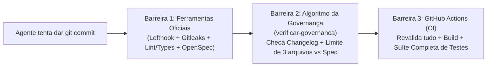

# Níveis de Cerimônia e Aplicação Real das Regras (D14 + D15)

> **Papel:** Decisão de cerimônia (D14) e aplicação determinística das regras (D15). **Status:** Vigente. **Índice:** [00_INDICE_E_DECISOES.md](00_INDICE_E_DECISOES.md)
> **Atualizado:** 27/10/2026

---

## Princípio Central: Quem Audita Quem?

> **O Agente executa; o Algoritmo Determinístico da Governança audita e trava.**

Pedir para um agente de IA fiscalizar a si mesmo é como pedir para o aluno corrigir a própria prova: se ele alucinar ou esquecer uma regra, vai jurar que cumpriu tudo.

Por isso, na v2 a responsabilidade é dividida com **Zero-Trust no Agente**:
1. **Papel do Agente (Executor):** Segue o fluxo (Test-First, escreve código, atualiza `CHANGELOG.md`, apresenta evidências no Gate 2) e tenta executar o commit.
2. **Papel do Algoritmo da Governança (Juiz Determinístico):** No momento do `git commit` (localmente via **Lefthook**) e do `git push` (remotamente via **GitHub Actions**), entra em ação **código determinístico puro (zero IA)** que inspeciona o `git diff` real e **bloqueia a operação (`exit 1`)** se qualquer regra tiver sido violada.
3. **Efeito Prático:** Se o agente esquecer o `CHANGELOG.md`, tentar passar 5 arquivos num `/fix` sem spec ou deixar um erro de tipo, o terminal recusa o commit e devolve o erro para o agente consertar obrigatoriamente.

---

## Parte 1 — Níveis de Cerimônia (D14)

### A Regra de Fronteira (Objetiva e Auditável)

| Critério | **Nível 1 — Via Rápida (`/fix`)** | **Nível 2 — Ciclo Completo (Feature / Mudança)** |
|---|---|---|
| **Quando usar** | Bug pontual, ajuste visual, refatoração interna sem mudar contratos, correção de texto/lint | Funcionalidade nova, mudança de regra de negócio, alteração de schema/banco, nova rota/API, nova dependência |
| **Muda comportamento da base viva (`openspec/specs/`)?** | **Não** (corrige o código para cumprir o que já era esperado) | **Sim** (adiciona, altera ou remove requisito) |
| **Toca em quantos arquivos de lógica?** | Até **3 arquivos** de produção (fora testes) | Qualquer quantidade |
| **Exige Gate 1 (aprovação prévia do plano)?** | **Não** — diagnóstico direto | **Sim, obrigatório** |
| **Exige Test-First (vermelho → verde)?** | **Sim** (teste que reproduz o bug falhando → correção → verde) | **Sim, obrigatório** |
| **Exige Gate 2 (evidências antes do commit)?** | **Sim** (saída do teste + diff limpo + `CHANGELOG.md`) | **Sim, completo** (+ `openspec archive`) |

> **Trava de segurança (Escalonamento Automático):** Se durante um `/fix` o commit tocar em mais de 3 arquivos de produção, alterar `package.json`/`pyproject.toml` (nova dependência) ou migrações de banco sem existir um delta ativo em `openspec/changes/`, **o script da governança bloqueia o commit automaticamente** e exige a abertura do Nível 2.

---

## Parte 2 — Aplicação Real das Regras / Enforcement (D15)

### As 3 Camadas de Barreira Determinística

### O que o Algoritmo Valida (Sem Depender do Agente)

| Regra da Constituição | Quem executa a checagem | Como o algoritmo trava (`exit 1`) |
|---|---|---|
| **Orquestrador de Git Hooks** | **Lefthook** (`lefthook.yml`) | Dispara automaticamente pelo próprio Git em todo `pre-commit` e `commit-msg`. |
| **Zero Vazamento de Segredos** | **Gitleaks** (`gitleaks protect --staged`) | Varre o diff em busca de chaves, tokens, senhas e `.env`. Achou → bloqueia. |
| **Código Limpo e Tipado** | **TSC / Biome / ESLint / Ruff / Pyright** | Roda nos arquivos staged. Erro de tipo ou lint → bloqueia. |
| **Integridade das Specs** | **OpenSpec CLI** (`openspec validate`) | Valida a estrutura de `openspec/specs/` e `openspec/changes/`. |
| **Changelog a Cada Commit** | **Algoritmo da Governança** (`verificar-governanca`) | Se o `git diff --cached` tem arquivos de código e o commit é `feat`/`fix`/`perf`/`refactor`, exige que `CHANGELOG.md` também esteja no commit. |
| **Fronteira Nível 1 (`/fix`) vs. Nível 2** | **Algoritmo da Governança** (`verificar-governanca`) | Conta os arquivos de produção no `git diff --cached`. Se > 3 arquivos (ou se alterou manifesto de dependências/schema) e não há mudança ativa em `openspec/changes/`, bloqueia exigindo Nível 2. |
| **Mensagens de Commit em PT-BR** | **Algoritmo da Governança** (`commit-msg`) | Valida regex `<tipo>(<escopo>): <descrição em português com mínimo de caracteres>`. |
| **Zero Testes Quebrados e Build Limpo** | **GitHub Actions (`.github/workflows/ci.yml`)** | Roda toda a bateria acima + suíte completa de testes + build de produção no servidor do GitHub. |

---

## Decisões Confirmadas

- [x] **D14 (ex-P4):** Dois níveis de cerimônia (`/fix` até 3 arquivos sem mudar requisito vs. Feature com OpenSpec completo) com trava automática de escalonamento.
- [x] **D15 (ex-P7):** Aplicação determinística via **Lefthook + Gitleaks + `openspec validate` + script `verificar-governanca` + GitHub Actions CI**, onde o algoritmo audita e trava o agente.
