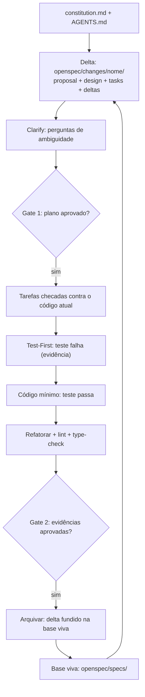

# Síntese dos Frameworks SDD — o que a v2 absorve de cada um

> **Papel:** Método de trabalho. **Status:** Vigente (motor definido em **D11**). **Índice:** [00_INDICE_E_DECISOES.md](00_INDICE_E_DECISOES.md)
> **Atualizado:** 27/10/2026 (revisão: pastas corrigidas para as estruturas reais; **D11 aprovada: OpenSpec + `constitution.md`**; Test-First e níveis de cerimônia adicionados)

---

## 1. O que cada um faz melhor

| Framework | Ponto forte | Limitação | O que absorvemos |
|---|---|---|---|
| **GitHub Spec Kit** | Constituição + fluxo `/speckit.specify → clarify → plan → tasks → implement` | Specs por feature (`specs/NNN-nome/`) não se fundem numa base viva; acumulam | **Constituição (`constitution.md`)** e a etapa **clarify** (tirar ambiguidades antes de planejar) |
| **OpenSpec** | **Base viva** (`openspec/specs/`) + **deltas** (`openspec/changes/`) fundidos ao arquivar (propagação ascendente) | — | **Motor oficial de specs (D11): base viva + deltas + arquivamento** |
| **Kiro (AWS)** | Propagação descendente: requisito mudou → tarefas recalculadas checando o código | IDE comercial | **Regra:** antes de gerar/refazer tarefas, o agente verifica o que o código já atende |
| **BMAD-METHOD** | Papéis com entrega formal entre eles | Pesado demais para mudanças simples | **3 posturas sequenciais** num mesmo agente, sem sub-agentes obrigatórios |

## 2. Decisão do Motor de Specs (D11 — Fechada)

Spec Kit e OpenSpec cumpriam a mesma função com pastas e comandos diferentes. Foi aprovada a **Opção (a)**:

- **OpenSpec como motor oficial:** `openspec/specs/` (base viva por domínio) + `openspec/changes/` (deltas em andamento e `archive/`).
- **`constitution.md` na raiz do repositório:** guarda as cláusulas pétreas e é referenciado diretamente pelo `AGENTS.md`.

## 3. Ciclo Unificado

## 4. As 3 Posturas (absorvidas do BMAD)

1. **Produto:** regras de negócio, critérios de aceite, valor. Sem falar de código.
2. **Arquitetura:** contratos, schema, impacto, riscos, ADR se a decisão for estrutural → **Gate 1**.
3. **Engenharia:** Test-First, implementação, evidências, limitações declaradas → **Gate 2**.

## 5. Test-First com Evidência (cláusula)

- Para cada comportamento: escrever o teste → **rodar e mostrar a falha pelo motivo certo** → código mínimo → rodar e mostrar o teste passando → refatorar.
- No Gate 2, a entrega inclui as **duas saídas** (vermelha e verde). Sem isso, não está pronto (Honestidade Radical).
- O Spec Kit só **recomenda** isso; na v2 **é cobrado** no Gate 2 e protegido pelo CI.

## 6. Níveis de Cerimônia (herança da v1, para evitar burocracia)

| Nível | Quando | Fluxo |
|---|---|---|
| **1 — `/fix`** | Bug pontual, ajuste pequeno, sem mudar comportamento especificado | Diagnóstico → teste que reproduz → correção → evidência → commit. **Sem delta de spec.** |
| **2 — Feature** | Comportamento novo ou alterado, refatoração ampla, arquitetura | Ciclo completo da seção 3 com os gates |

Se um `/fix` revelar mudança de comportamento, ele sobe para o Nível 2.
