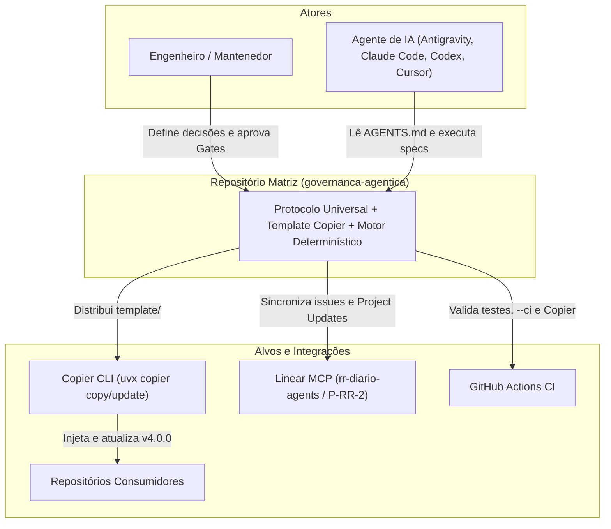
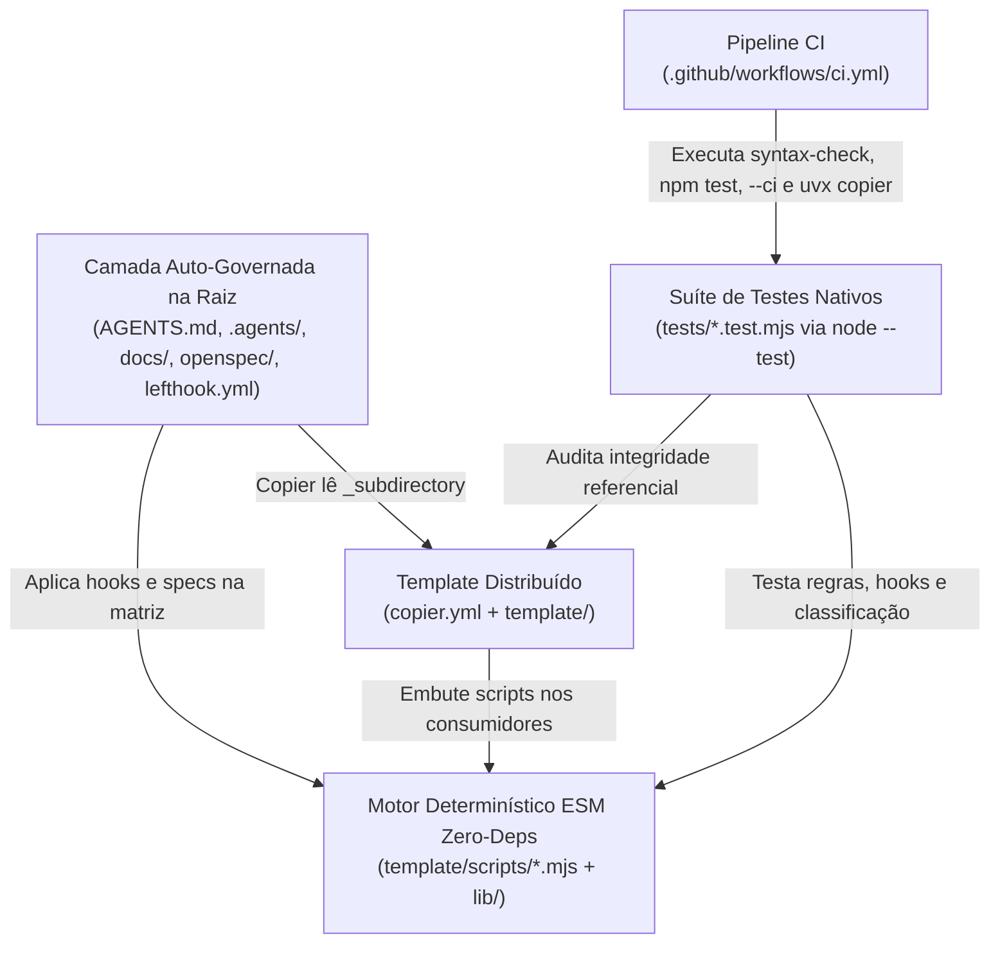

# Arquitetura do Sistema — Repositório Matriz (`governanca-agentica`)

> **Papel:** Documentação viva da arquitetura do protocolo **Governança v4.0.0**, seus fluxos de distribuição via Copier, módulos determinísticos em Node.js ESM e mapa físico real do repositório matriz.
> **Nota sobre Banco de Dados:** Este repositório (`cli-biblioteca`) não possui banco de dados nem tabelas persistentes; o estado vivo reside em arquivos versionados (`openspec/`, `CHANGELOG.md`, `00_INDICE_E_DECISOES.md`).

---

## 1. Visão Geral e Contexto de Negócio (C4 Nível 1 — Contexto)

---

## 2. Contêineres e Módulos Internos (C4 Nível 2 — Contêineres)

---

## 3. Modelo de Dados e Armazenamento de Decisões

Este repositório matriz é *stateless* e não opera banco relacional ou `erDiagram`. A persistência do estado arquitetural segue três estruturas em disco:
- **Especificações e Roadmap Vivo (`openspec/`):** Fonte de planejamento macro (`openspec/roadmap.md`), deltas ativos (`openspec/changes/`) e especificações consolidadas (`openspec/specs/`).
- **Registro Oficial de Decisões (`00_INDICE_E_DECISOES.md`):** Mantém as decisões `D1`–`D41` em formato consolidado, substituindo diretórios `docs/adr/` nesta matriz.
- **Estado Efêmero Local (`.agents/handoff.md`):** Arquivo gitignored utilizado opcionalmente entre sessões sem delta OpenSpec ativo.

---

## 4. Glossário de Domínio

| Termo | Significado Oficial na Matriz |
|---|---|
| **Matriz** | Este repositório (`governanca-agentica`), origem do template Copier e do motor determinístico. |
| **Consumidor** | Projeto alvo que recebe a governança via `uvx copier copy` a partir de `template/`. |
| **Padrão Universal Puro (D40)** | Estrutura agnóstica (`AGENTS.md` + `.agents/`) sem wrappers proprietários redundantes. |
| **Fatia / Rolling Wave** | Unidade incremental de entrega registrada em `openspec/roadmap.md` com especificação Just-in-Time em `openspec/changes/`. |
| **Via 1a / 1b / 1.5 / 2** | Graus proporcionais de cerimônia validados por `classificar-cerimonia.mjs` no estágio `commit-msg` e `--ci`. |
| **Catraca Anti-Monólito** | Bloqueio que impede arquivos legados > 350 linhas úteis (como `verificar-governanca.mjs`) de crescerem sem modularização em `lib/`. |
| **Tríade de Âncora** | Isolamento obrigatório no Linear MCP: Workspace (`rr-diario-agents`), Equipe (`RR`) e Projeto (`P-RR-2`). |

---

## 5. Mapa Físico de Módulos (Onde Cada Coisa Mora)

> **Objetivo:** Localizar módulos da matriz e suas suítes sem varreduras repetidas. Todo caminho entre crases nesta tabela é verificado pelo sensor anti-apodrecimento em `verificar-governanca.mjs`.

| Camada / Domínio | Caminho Real na Matriz | Responsabilidade Principal | Suíte / Validador Correspondente |
|---|---|---|---|
| **Auto-Governança na Raiz** | `AGENTS.md` | Entrada universal do agente na matriz (perfil biblioteca + comandos + ponteiros em fonte única) | `tests/autogovernanca-dogfooding.test.mjs` |
| **Lifecycle Hooks da Matriz** | `.agents/hooks.json` | Aciona proteções pré-ferramenta e injeção de sessão apontando para o script único do template | `tests/autogovernanca-dogfooding.test.mjs` |
| **Regras Modulares da Matriz** | `.agents/rules/` | Regras glob para evolução do template e protocolo Linear MCP com Tríade da matriz | `tests/autogovernanca-dogfooding.test.mjs` |
| **Pipeline Git e CI da Matriz** | `lefthook.yml` | Hooks locais (`pre-commit`, `commit-msg`, `pre-push`) executando testes e auditoria | `.github/workflows/ci.yml` |
| **Manifesto Copier** | `copier.yml` | Questionário, filtros Jinja, isolamento de template e proteção `_skip_if_exists` | `tests/template-docs.test.mjs` |
| **Constituição e Entrada do Template** | `template/constitution.md` | Lei Suprema e cláusulas pétreas compartilhadas pela matriz e pelos consumidores | `tests/desburocratizacao-sdd-v4.test.mjs` |
| **Instruções e Guias Distribuídos** | `template/AGENTS.md` | Ponto de entrada e índice universal injetado nos projetos consumidores | `tests/template-docs.test.mjs` |
| **Skills e Rules Distribuídas** | `template/.agents/skills/` | Fluxos operacionais agênticos (ciclo de fatias, revisão forense, onboarding, segurança, UX) | `tests/template-docs.test.mjs` |
| **Regras Condicionais do Template** | `template/.agents/rules/` | Módulos carregados por perfil/glob (`web-ui`, backend, jogos e Linear) | `tests/regras-modulares-e-docs-mercado.test.mjs` |
| **Auditor Determinístico** | `template/scripts/verificar-governanca.mjs` | Orquestração modular ≤ 350 linhas e agregador de violações/válvulas (`--staged` e `--ci`) | `tests/blindagem-motor-e-agregador.test.mjs` |
| **Helper Git Diff/CI** | `template/scripts/lib/git-diff-helper.mjs` | Abstração de diff/conteúdo local (`--staged`) e CI (`--ci` sobre HEAD~1 e HEAD) | `tests/blindagem-motor-e-agregador.test.mjs` |
| **Auditoria OpenSpec/Roadmap** | `template/scripts/lib/auditar-openspec.mjs` | Validação pura de roadmap v3/v4, deltas OpenSpec e trava de archive | `tests/verificar-governanca.test.mjs` |
| **Sensores de Código e Testes** | `template/scripts/lib/sensores-codigo.mjs` | Reatividade limpa, integridade de testes, variáveis de ambiente, anti-monólito e válvulas | `tests/blindagem-motor-e-agregador.test.mjs` |
| **Sensores de Índices e Avisos** | `template/scripts/lib/sensores-indices.mjs` | Anti-apodrecimento de catálogo e mapa físico, além de avisos operacionais | `tests/verificar-governanca.test.mjs` |
| **Classificador de Arquivos** | `template/scripts/lib/classificar-arquivos.mjs` | Classificação determinística de produção, testes, banco, manifestos e templates | `tests/desburocratizacao-sdd-v4.test.mjs` |
| **Classificador de Cerimônia** | `template/scripts/lib/classificar-cerimonia.mjs` | Enforcement das Vias 1a, 1b, 1.5 e 2 no estágio `commit-msg` e CI | `tests/validar-commit-msg.test.mjs` |
| **Executor Auxiliar Lefthook** | `template/scripts/lib/lefthook-runner.mjs` | Comandos e condições `skip` portáteis do `lefthook.yml` (Windows/POSIX) | `tests/piramide-testes-e-ci-poliglota.test.mjs` |
| **Auditor Matriz de Requisitos** | `template/scripts/lib/auditar-matriz-requisitos.mjs` | Auditoria *opt-in* de `template/openspec/matriz-requisitos.md.jinja` e resumo para `SessionStart` | `tests/auditar-matriz-requisitos.test.mjs` |
| **Validador de Commits** | `template/scripts/validar-commit-msg.mjs` | Hook `commit-msg` (Conventional Commits PT-BR + vínculo OpenSpec/CHANGELOG) | `tests/validar-commit-msg.test.mjs` |
| **Runtime de Hooks de Agente** | `template/scripts/hook-agente.mjs` | Proteção `PreToolUse` (`--no-verify`, env protegido, `force_ask`) e resumo `SessionStart` | `tests/hook-agente.test.mjs` |
| **Docs Modelo do Template** | `template/docs/` | Modelos vivos copiados aos consumidores (arquitetura, reúso, particularidades, runbook, aprendizados) | `tests/template-docs.test.mjs` |
| **Auto-Specs e Roadmap da Matriz** | `openspec/` | Rolling Wave em `openspec/roadmap.md`, specs consolidadas e deltas da própria governança | `openspec/roadmap.md` |
| **Decisões Históricas da Matriz** | `00_INDICE_E_DECISOES.md` | Registro canônico de decisões (`D1`–`D41`), sem pasta separada de ADRs na matriz | `tests/` |
