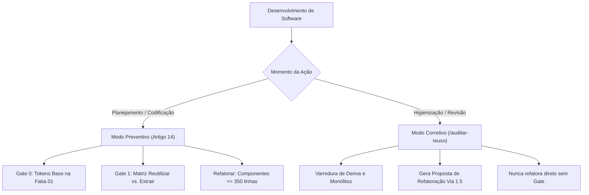

# Skill: Governança de Reúso, Tokens de Movimento e Component-as-Asset

Esta skill orienta o agente na prevenção de deriva estética/cinética e na eliminação de arquivos monolíticos, aplicando o **Artigo 14 da Constituição** em aplicações Web, Desktop, Mobile e Jogos/Simulações.

---

## 1. Modos de Atuação da Governança de Reúso

---

## 2. Modo Preventivo (Durante o Ciclo de Desenvolvimento)

### 2.1. No Gate 0 (Fundação — Fatia 01)
Em qualquer projeto com interface visual ou interativa (`web-ui`, `desktop`, `mobile`, `jogo`), a Fatia 01 DEVE obrigatoriamente:
1. Definir os **Tokens Base** em arquivo central (ex.: `tokens.css`, `theme.ts` ou recurso de configuração da engine):
   - Cores semânticas da paleta;
   - Tipografia e escala modular;
   - **Durações e curvas canônicas de animação/easing:** microinterações (150ms), painéis/modais (250ms), curvas suaves (`cubic-bezier(0.4, 0, 0.2, 1)`).
2. Criar ou inicializar `docs/catalogo-reuso.md` com os ponteiros dos tokens e primitivos fundacionais.

### 2.2. No Gate 1 e `/fix` (Planejamento e Design)
Antes de escrever código ou propor componentes em `design.md`:
1. Leia `docs/catalogo-reuso.md`.
2. Declare explicitamente no plano:
   - **O que será reutilizado:** componentes existentes (`Botao`, `ModalConfirmacao`, `ToastNotificacao`, prefabs).
   - **O que será extraído e catalogado:** novos primitivos ou utilitários genéricos que nascem nesta fatia.

### 2.3. Na Etapa de Refatoração (Faça Direito)
- **Regra de 1ª e 2ª Ocorrência:**
  - Primitivos visuais, animações e entidades de jogos nascem componentizados na **1ª ocorrência**.
  - Blocos específicos de tela ou lógica de domínio repetidos extraem-se na **2ª ocorrência**.
- **Teto Anti-Monólito (350 Linhas Úteis):**
  - Mantenha funções e arquivos atômicos.
  - Ao aproximar-se de 350 linhas úteis, extraia subcomponentes ou hooks/módulos imediatamente.
  - Se estiver alterando arquivo legado (> 350 linhas em `HEAD`), a catraca permite alteração contanto que as linhas totais não aumentem.

---

## 3. Modo Corretivo: O Comando `/auditar-reuso`

O comando `/auditar-reuso` pode ser acionado a qualquer momento pelo usuário ou pelo agente para diagnosticar dívida técnica e deriva visual:

### 3.1. Roteiro de Varredura
1. **Auditoria de Deriva Estética e Cinética:**
   - Varre arquivos em busca de cores hexadecimais arbitrariamente inseridas fora dos tokens.
   - Identifica animações inline com durações discrepantes (ex.: 300ms, 500ms aleatórios) em vez dos tokens padronizados.
2. **Auditoria de Monólitos e Cenas Gigantes:**
   - Varre arquivos de produção (`.tsx`, `.ts`, `.vue`, `.svelte`, `.gd`, `.rs`, `.cs`) medindo linhas úteis via algoritmo determinístico.
   - Lista arquivos que excedem 350 linhas ou que estejam no limiar de risco.
3. **Auditoria por Engine / Stack:**
   - **Web / Apps:** detecta botões, dialogs ou skeletons clonados entre rotas sem consumo do catálogo.
   - **Godot 4:** detecta scripts `.gd` de cenas principais contendo mecânicas de inimigos ou física que deveriam ser Cenas atômicas compostas por nós e `Resource` customizados.
   - **Phaser 3 / Three.js / R3F / Bevy:** detecta malhas, geometrias ou sistemas sem reaproveitamento e shaders não modulados.

### 3.2. Saída do `/auditar-reuso`
O agente DEVE apresentar o relatório diagnóstico contendo:
- Tabela de arquivos com risco de monólito (> 350 linhas úteis);
- Lista de primitivos duplicados com sugestão de unificação;
- Proposta de fatias de refatoração estrutural no Nível 1.5 (Via 1.5: `refactor` sem quebra de contratos).
- **Regra de Ouro:** O agente NUNCA deve sair refatorando arquivos diretamente após o `/auditar-reuso`. Ele apresenta o relatório e aguarda o direcionamento humano.
