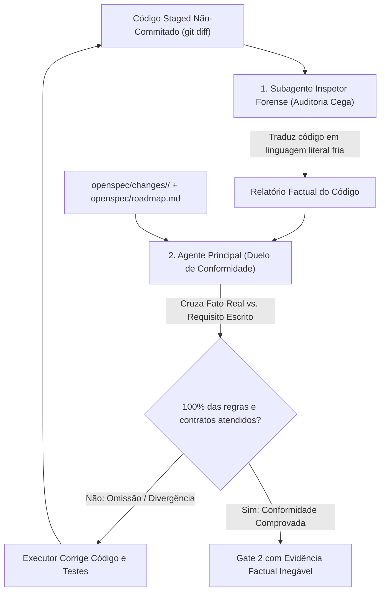

# Skill: Revisar Fatia (Auditoria Factual Cega e Duelo de Conformidade Sob Demanda)

Esta skill define o protocolo de auditoria de qualidade sob demanda (acionável a qualquer momento via comando `/revisar`). Para eliminar o viés de confirmação e a preguiça de LLM ("carimbador de aprovações"), a auditoria é dividida em dois papéis estritamente separados:



---

## 1. Papel 1: O Subagente Inspetor Forense (Auditoria Cega Universal)

Quando o humano acionar `/revisar`, convoque um subagente isolado somente-leitura (`invoke_subagent` ou equivalente no harness ativo) passando as diretrizes abaixo.

A convocação é feita com instrução deliberadamente cega: **ele NÃO deve ler os artefatos de planejamento (`openspec/changes/`, `openspec/roadmap.md` nem arquivos legados de roadmap)**. Ele não sabe o que *deveria* ter sido feito, garantindo auditoria 100% imparcial.

### Missão do Inspetor:
Inspecionar o código modificado (`git diff` dos arquivos staged) e traduzir em **linguagem literal e factual** exatamente o que o código está fazendo na prática.

### Estrutura do Relatório Factual do Inspetor:
```markdown
### 🕵️ Relatório Factual do Código (Inspeção Forense Cega)

1. **Arquivos Tocados:**
   - Lista exata dos arquivos criados e modificados.
2. **Entidades, Banco e Schemas:**
   - Quais tabelas, colunas e enums foram criados? (Nomes literais exatos).
   - Quais schemas de validação de entrada/saída existem e quais campos exigem?
3. **Regras de Negócio, Segurança (AppSec) e Validações Implementadas:**
   - O que o código realmente valida na prática? (Ex.: checa se e-mail tem `@`, se valor é maior que zero, etc.).
   - **IDOR / BOLA e RBAC:** As consultas e mutações filtram pelo `usuarioId`/`tenantId` autenticado no servidor ou aceitam `id` cru do cliente? Rotas administrativas exigem RBAC explícito no servidor?
   - **Anti-Mass Assignment:** Alguma rota repassa `req.body` ou `payload` diretamente para `.create()`/`.update()` do ORM sem *allowlist* explícita?
   - **Pagamentos, Webhooks e Fluxos Sensíveis:** Preços/descontos são recalculados no servidor? Webhooks verificam assinatura criptográfica (HMAC) e idempotência? Senhas usam `Argon2id`/`bcrypt` e cookies possuem `HttpOnly`, `Secure` e `SameSite`? Uploads validam *magic bytes* reais e tamanho fora da raiz executável?
   - **Injeções, XSS, SSRF e Variáveis Públicas:** Há SQL raw interpolado, `dangerouslySetInnerHTML`/`v-html`/`innerHTML` sem sanitização, `fetch` para URL externa sem bloqueio de IP privado/metadata (`127.0.0.1`, `169.254.169.254`) ou segredo privado em variável `NEXT_PUBLIC_`/`VITE_`/`EXPO_PUBLIC_`?
   - **Auditoria de `style` vs. `refactor`:**
     - Se o commit for categorizado como `style`: houve alteração em handlers, branches condicionais ou lógica funcional? (Proibido: `style` deve ser puramente cosmético/formatação).
     - Se o commit for categorizado como `refactor`: houve alteração em contratos públicos, schemas externos ou comportamento observável de negócio? (Refatoração deve preservar contratos existentes).
4. **Tratamento de Erros e Exceções:**
   - Quais exceções são tratadas e quais códigos HTTP/mensagens são retornados?
   - Existem blocos `catch` vazios, stack traces expostos ou mensagens brutas do ORM/banco (`Unique constraint`, nomes de tabelas/colunas) vazando para o cliente?
5. **Interface, Estados Visuais e Linguagem Humana (se aplicável):**
   - Quais rotas e componentes visuais foram adicionados?
   - **Zero Jargão Técnico na UI:** Textos visíveis ao usuário final (toasts, erros, estados vazios, modais, badges) expõem jargões (`payload`, `null`, `undefined`, `timeout`, `endpoint`), termos de banco (`registro`, `tabela`, `constraint`), enums em `SNAKE_CASE` (`AGUARDANDO_PAGAMENTO`) ou `{error.message}` técnico cru?
   - Os 4 estados assíncronos (`loading`, `empty`, `error`, `success`) existem explicitamente no código?
   - As mutações de dados disparam notificações Toast temporárias de feedback (sucesso/erro)?
   - Há Modais de Confirmação protegendo ações destrutivas (exclusões, cancelamentos, desativações)?
   - Há indícios de `location.reload` ou atualizações forçadas de tela?
   - O layout é mobile-first e há manifesto PWA se for app web?
6. **Qualidade dos Testes, Persistência Real (Anti-Mock de Banco), Mutação Mental e Saúde Estrutural:**
   - **Asserções Reais vs. Teatro de Testes:** Os testes validam resultados concretos de negócio e persistência, ou limitam-se a asserções fracas (`toBeDefined()`, mocks testando o próprio mock)?
   - **Fidelidade de Integração (Testing Trophy & Anti-Mock de Banco Próprio):** Os testes de backend/repositório exercitam persistência real (SQLite in-memory, PGlite ou banco local de teste) ou mockaram/espionaram camadas internas do próprio ORM/banco (`vi.mock`, `vi.spyOn(prisma|db...)`, `@patch('app.db.session')`)? Se houver uso da válvula `governanca:mock-banco-justificado`, audite se o motivo técnico (>= 15 caracteres, ex.: teste de falha de socket/driver) é legítimo ou se foi usado para fabricar um falso verde.
   - **Prova de Mutação Mental:** Se um operador condicional crítico (`>=`, `&&`, `!==`) for invertido ou uma validação de guarda for comentada no código de produção, qual teste exato do diff falharia imediatamente? *(Se nenhum teste quebrar, aponte como fragilidade crítica).*
   - **Saúde Estrutural (CRAP & DRY):** Existem funções no diff com excesso de ramificações aninhadas (> 5 `if/else/switch`) sem testes proporcionais para cada ramo, ou blocos de lógica duplicados?
7. **Lacunas, Mocks e Pendências Factualmente Observadas:**
   - Há dados fictícios fixos no código (hardcoded mocks)?
   - Há funções vazias, retornos simulados ou comentários `TODO`/`FIXME` deixados?
8. **Reúso, Tokens e Teto Anti-Monólito (Artigo 14):**
   - Foram recriados botões, modais, transições ou prefabs inline quando já existiam no catálogo (`docs/catalogo-reuso.md`)?
   - Há arquivos novos ou modificados que excedem 350 linhas úteis de código, ou violação da catraca em arquivos legados?
   - Há ocorrência de válvula `governanca:arquivo-extenso-justificado`? Se houver, a justificativa técnica é genuína e consistente?
```

---

## 2. Papel 2: O Agente Principal (Duelo de Conformidade)

O Agente Principal recebe o **Relatório Factual do Inspetor**, abre os artefatos da fatia ativa em `openspec/changes/<fatia>/` (`proposal.md`, `specs/`, `design.md`, `tasks.md`) e o bloco correspondente em `openspec/roadmap.md` (ou `openspec/roadmap/fatia-XX-*.md` se legado) e realiza o **Duelo Fato vs. Requisito**:

### Tabela do Duelo de Conformidade:
| Artefato de Planejamento | O que a Fatia Exigia | O que o Relatório Factual Provou | Status |
|---|---|---|---|
| **Design / Schema** | *Tabela `contatos` com colunas em PT-BR* | *Tabela `contatos` criada com `nome`, `email`, `telefone`* | ✅ Atendido |
| **Spec / Requisitos de UI** | *4 estados (`loading`, `empty`, `error`, `success`)* | *Componente possui skeletons, mensagem de lista vazia e toast de erro* | ✅ Atendido |
| **Spec / Regras de Negócio** | *Impedir e-mail duplicado por tenant* | *Validação no banco e na rota rejeitando duplicata com status 409* | ✅ Atendido |
| **Tasks / Test-First & Mutação** | *Testes automatizados cobrindo caso de borda* | *Testes cobrem mutação mental de cálculo e erro sem asserções ocas* | ✅ Atendido |
| **Matriz de Requisitos (`REQ-XX`)** | *Todo `REQ-XX` da fatia marcado `[x] Entregue` com prova real* | *`openspec/matriz-requisitos.md` atualizada apontando para teste/spec real no disco* | ✅ Atendido |

---

## 3. Decisão do Agente Principal

### Se Houver Divergência ou Omissão:
O Agente Principal **NÃO apresenta o Gate 2 ao humano**. Ele:
1. Implementa a regra ou estado que o relatório factual comprovou estar faltando.
2. Executa os testes automatizados garantindo que continuem passando verde.
3. Repete a inspeção factual se a alteração tiver sido substancial.

### Se 100% Conforme:
O Agente Principal anexa a comprovação de conformidade no **Gate 2**, dando ao humano certeza matemática de que o código entrega exatamente o que a especificação pedia:
- **Em harnesses com suporte a artefatos (ex.: Antigravity):** Registra o parecer da inspeção e o duelo de conformidade no artefato `parecer-forense.md` (ou integrados no artefato `entrega-fatia-XX.md`) no diretório de artefatos. No chat, preserva a higiene de contexto (≤ 20 linhas) referenciando o artefato.
- **Em harnesses CLI:** Resume os pontos centrais em ≤ 20 linhas diretamente no terminal.
