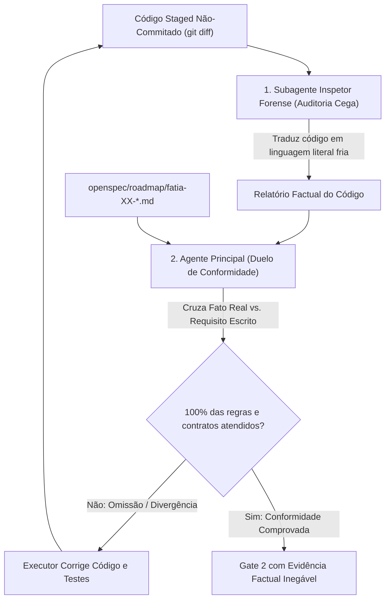

# Skill: Revisar Fatia (Auditoria Factual Cega e Duelo de Conformidade)

Esta skill define o protocolo de auditoria de qualidade pré-Gate 2. Para eliminar o viés de confirmação e a preguiça de LLM ("carimbador de aprovações"), a auditoria é dividida em dois papéis estritamente separados:



---

## 1. Papel 1: O Subagente Inspetor Forense (Auditoria Cega)

O Subagente Inspetor é convocado com uma instrução deliberadamente cega: **ele NÃO deve ler o arquivo de roadmap (`openspec/roadmap/fatia-XX-*.md`)**. Ele não sabe o que *deveria* ter sido feito, evitando qualquer simpatia contextual ou suposição de intenção.

### Missão do Inspetor:
Inspecionar o código modificado (`git diff` dos arquivos staged) e traduzir em **linguagem literal e factual** exatamente o que o código está fazendo na prática.

### Estrutura do Relatório Factual do Inspetor:
```markdown
### 🕵️ Relatório Factual do Código (Inspeção Forense Cega)

1. **Arquivos Tocados:**
   - Lista exata dos arquivos criados e modificados.
2. **Entidades, Banco e Schemas:**
   - Quais tabelas, colunas e enums foram criados? (Nomes literais exatos).
   - Quais schemas de validação de entrada/saída existem e quais campos exigem?
3. **Regras de Negócio e Validações Implementadas:**
   - O que o código realmente valida na prática? (Ex.: checa se e-mail tem `@`, se valor é maior que zero, etc.).
   - Quais checagens de autorização/permissão são feitas antes de persistir dados?
4. **Tratamento de Erros e Exceções:**
   - Quais exceções são tratadas e quais códigos HTTP/mensagens são retornados?
   - Existem blocos `catch` vazios ou erros engolidos silenciosamente?
5. **Interface e Estados Visuais (se aplicável):**
   - Quais rotas e componentes visuais foram adicionados?
   - Os 4 estados assíncronos (`loading`, `empty`, `error`, `success`) existem explicitamente no código?
   - As mutações de dados disparam notificações Toast temporárias de feedback (sucesso/erro)?
   - Há Modais de Confirmação protegendo ações destrutivas (exclusões, cancelamentos, desativações)?
   - Há indícios de `location.reload` ou atualizações forçadas de tela?
   - O layout é mobile-first e há manifesto PWA se for app web?
6. **Lacunas, Mocks e Pendências Factualmente Observadas:**
   - Há dados fictícios fixos no código (hardcoded mocks)?
   - Há funções vazias, retornos simulados ou comentários `TODO`/`FIXME` deixados?
```

---

## 2. Papel 2: O Agente Principal (Duelo de Conformidade)

O Agente Principal recebe o **Relatório Factual do Inspetor**, abre o arquivo físico [`openspec/roadmap/fatia-XX-<slug>.md`](../../openspec/roadmap/_template-fatia.md) e realiza o **Duelo Fato vs. Requisito**:

### Tabela do Duelo de Conformidade:
| Seção do Roadmap Físico | O que a Fatia Exigia | O que o Relatório Factual Provou | Status |
|---|---|---|---|
| **Seção 3 (Contratos/Banco)** | *Tabela `contatos` com colunas em PT-BR* | *Tabela `contatos` criada com `nome`, `email`, `telefone`* | ✅ Atendido |
| **Seção 4 (Estados de UI)** | *4 estados (`loading`, `empty`, `error`, `success`)* | *Componente possui skeletons, mensagem de lista vazia e toast de erro* | ✅ Atendido |
| **Seção 5 (Regras Backend)** | *Impedir e-mail duplicado por tenant* | *Validação no banco e na rota rejeitando duplicata com status 409* | ✅ Atendido |
| **Seção 6 (Test-First)** | *Testes automatizados cobrindo caso de borda* | *Testes unitários e de integração cobrindo erro e sucesso* | ✅ Atendido |

---

## 3. Decisão do Agente Principal

### Se Houver Divergência ou Omissão:
O Agente Principal **NÃO apresenta o Gate 2 ao humano**. Ele:
1. Implementa a regra ou estado que o relatório factual comprovou estar faltando.
2. Executa os testes automatizados garantindo que continuem passando verde.
3. Repete a inspeção factual se a alteração tiver sido substancial.

### Se 100% Conforme:
O Agente Principal anexa o resumo factual da auditoria e a comprovação de conformidade diretamente no chat do **Gate 2**, dando ao humano certeza matemática de que o código entrega exatamente o que a especificação pedia.
