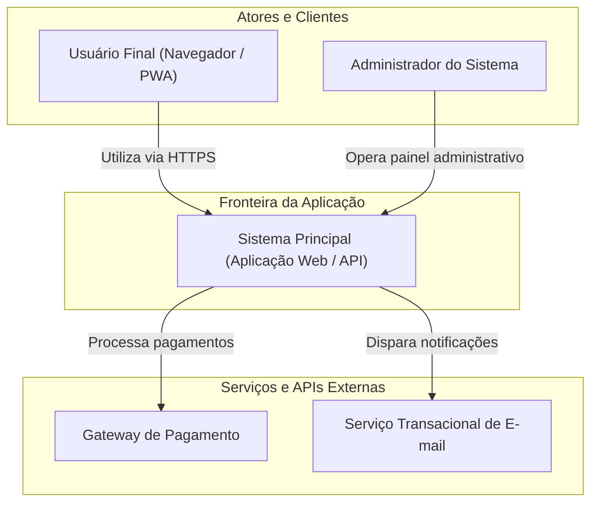
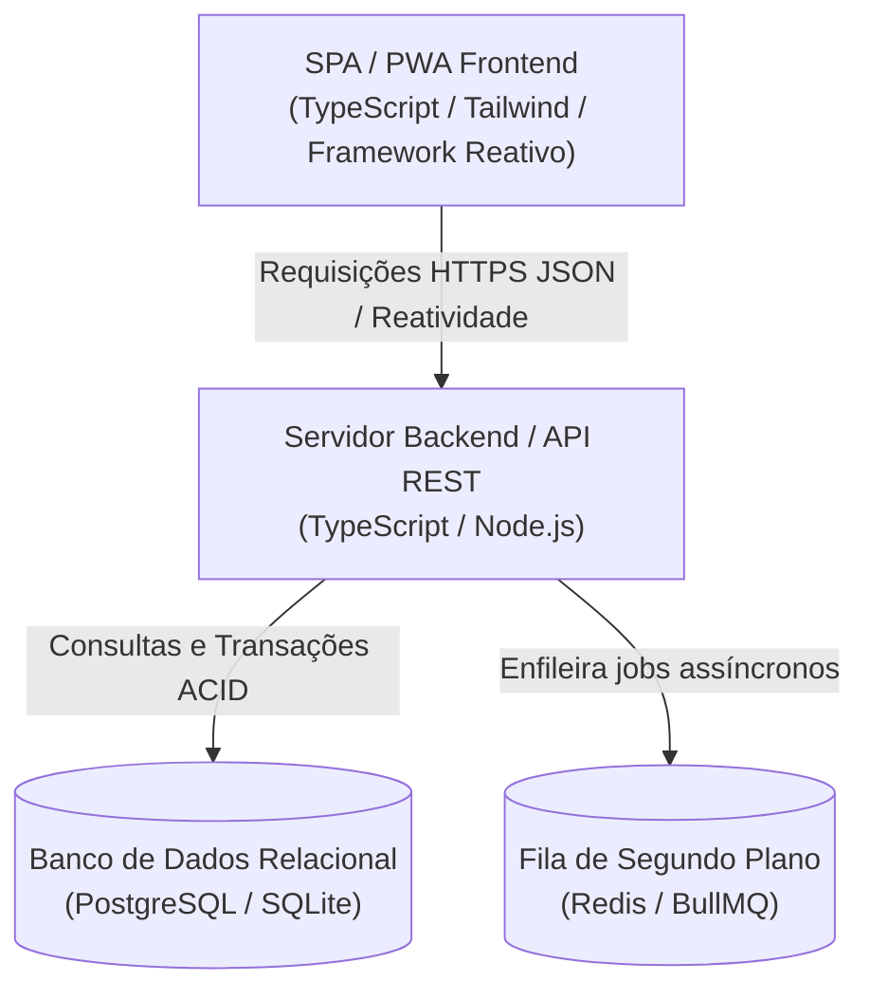
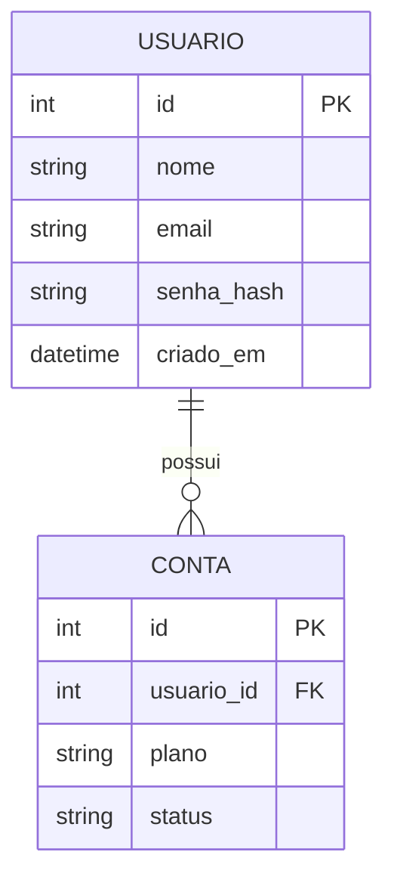

# Arquitetura do Sistema e Modelo de Dados

> **Papel:** Documentação viva de arquitetura de software no padrão de mercado (C4 Model + Entity-Relationship + Glossário de Domínio).
> **Gatilho de Atualização:** Toda alteração em esquemas de banco de dados (`schema.prisma`, migrações SQL) exige a atualização deste arquivo no mesmo commit (Fatia 09 / Artigo 7).
> **Proteção Copier:** Listado em `_skip_if_exists` no `copier.yml`.

---

## 1. Visão Geral e Contexto de Negócio (C4 Nível 1 — Contexto)

O diagrama abaixo ilustra os atores humanos, o sistema de software e suas integrações com serviços externos.

---

## 2. Contêineres e Aplicações (C4 Nível 2 — Contêineres)

Detalhamento dos componentes de infraestrutura, bancos e servidores executáveis.

---

## 3. Modelo Físico de Entidades (`erDiagram` — Como Construído)

Diagrama de relacionamentos das entidades de domínio persistidas no banco. Tabelas e colunas com nomes canônicos em Português do Brasil (Artigo 10).

---

## 4. Glossário de Domínio

Tabela canônica mapeando os conceitos de negócio, seus identificadores oficiais no código em PT-BR e as tabelas físicas correspondentes, eliminando ambiguidades entre squads e agentes de IA.

| Termo de Negócio | Identificador no Código (PT-BR) | Tabela / Coleção Física | Descrição e Regras |
|---|---|---|---|
| **Usuário** | `usuario`, `Usuario` | `usuarios` | Ator autenticado com e-mail corporativo único por tenant. |
| **Conta / Tenant** | `conta`, `Conta` | `contas` | Unidade de cobrança e isolamento lógico de dados da organização. |
| **Assinatura** | `assinatura`, `Assinatura` | `assinaturas` | Vínculo financeiro entre uma conta e um plano recorrente de uso. |
