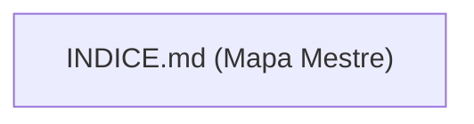

# Índice Mestre — Livro de Conhecimento e Descoberta

> **Papel (*Upstream*):** Repositório vivo de reflexão estratégica, regras de negócio amadurecidas e arquitetura conceitual construído via `/descobrir` (`/mesa`).
> **Fonte Única:** Este diretório **não substitui** `openspec/specs/` nem `openspec/roadmap.md`. Ideias amadurecidas aqui só viram contrato de implementação quando promovidas explicitamente ao roadmap.

---

## 1. Sumário de Capítulos

| Capítulo | Tema | Especialidade(s) | Status | Resumo (1 linha) |
|---|---|---|---|---|
| *(Nenhum capítulo extraído ainda)* | *Inicie uma sessão com `/descobrir` para cristalizar o primeiro capítulo* | — | — | — |

---

## 2. Grafo de Relações

---

## 3. Fios em Aberto e Próximas Perguntas

> Lista mantida para continuidade multi-sessão após `/compact` ou nova conversa.

- [ ] Definir a tese central do sistema, atores principais e tensões de negócio iniciais.

---

## 4. Uso para Síntese Externa (NotebookLM, Obsidian e Mega-Planos)

- **NotebookLM / Ferramentas de Síntese:** Faça upload deste `INDICE.md` em conjunto com os arquivos `*.md` de `docs/conhecimento/` para gerar resumos executivos, guias de estudo, podcasts de alinhamento e mapas mentais sem ruído de código.
- **Materiais Externos (`docs/conhecimento/materiais/`):** Salve exportações do NotebookLM, atas, diagramas textuais ou especificações brutas dentro de `docs/conhecimento/materiais/` para serem absorvidos junto com o livro.
- **Obsidian / Visualização em Grafo:** Abra a pasta `docs/conhecimento/` (ou a raiz do projeto) como *Vault*; o frontmatter YAML (`id`, `tema`, `especialidade`, `status`, `relacionados`) e os links relativos Markdown (`[Título](./<NN>-<slug>.md)`) montam o grafo automaticamente.
- **Promoção para Mega-Plano de Execução (`/sintetizar`):** Quando o domínio estiver maduro ou o volume passar de 8 arquivos, acione `/sintetizar` para converter o livro e os materiais em `openspec/roadmap.md` via extração *Map-Reduce* sem estourar o contexto.
